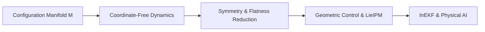

<link rel="stylesheet" href="styles.css" />

# A Lie-Interpretation of Robotics and Control

Welcome to the GitHub Pages reader for **A Lie-Interpretation of Robotics and Control**, developed under the **Elephant-Goldfish** architecture with typography and geometric diagrams inspired by [Keenan Crane's Discrete Differential Geometry](https://www.cs.cmu.edu/~kmcrane/Projects/DDG/).

## Interactive Textbook & Assets

| Part | Chapter | Manuscript | Colab Tutorial | Reusable Skill |
| :--- | :--- | :--- | :--- | :--- |
| **Front Matter** | Overview, Notation Standard & Master TOC | [Overview](../README.md) / [Notation](../NOTATION_STANDARD.md) | — | — |
| **Part I** | Ch. 1: Why Coordinate-Free Geometry? | [Chapter 1](../chapters/ch01_why_coordinate_free.md) | [Colab Notebook](../notebooks/ch01_singularities_unwinding.ipynb) | [ch01-manifold-diagnostics](../skills/ch01-manifold-diagnostics/SKILL.md) |
| **Part I** | Ch. 2: Core Manifolds & Product Spaces | [Chapter 2](../chapters/ch02_core_manifolds.md) | [Colab Notebook](../notebooks/ch02_lie_groups_product_manifolds.ipynb) | [ch02-manifold-kinematics](../skills/ch02-manifold-kinematics/SKILL.md) |
| **Part I** | Ch. 3: Variations, Errors & Transport Maps | [Chapter 3](../chapters/ch03_variations_errors_transport.md) | [Colab Notebook](../notebooks/ch03_variations_transport_maps.ipynb) | [ch03-geometric-error-design](../skills/ch03-geometric-error-design/SKILL.md) |
| **Part II** | Ch. 4: Coordinate-Free Dynamics | [Chapter 4](../chapters/ch04_coordinate_free_dynamics.md) | [Colab Notebook](../notebooks/ch04_lagrange_dalembert_sim.ipynb) | [ch04-manifold-dynamics-modeling](../skills/ch04-manifold-dynamics-modeling/SKILL.md) |
| **Part III** | Ch. 7: Variation Linearization & LTV-LQR | [Chapter 7](../chapters/ch07_variation_linearization_lqr.md) | [Colab Notebook](../notebooks/ch07_variation_lqr_sim.ipynb) | [ch07-variation-lqr-design](../skills/ch07-variation-lqr-design/SKILL.md) |

## Architecture Schematic (Mermaid)

